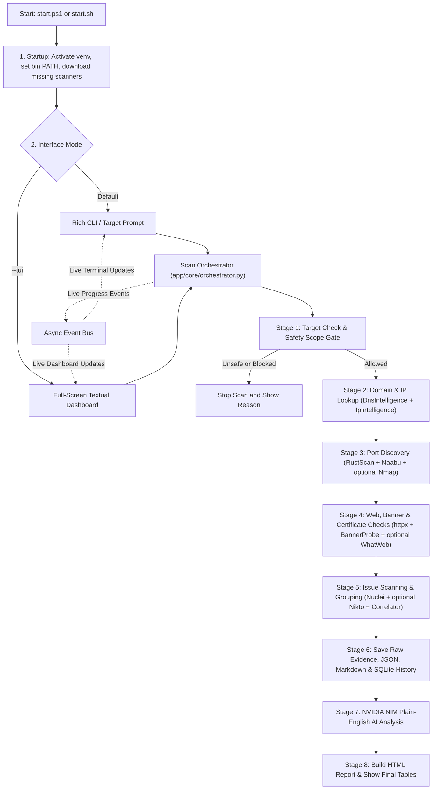

# RootScan

RootScan is a local security scanning toolkit built in Python. You give it a domain name or IP address, and it automatically checks your safety scope, collects basic network details, finds open ports, checks websites and security certificates, looks for common security issues, saves reports on your computer, and uses NVIDIA NIM AI to explain the results in simple English.

You can use it in two ways from your terminal:
- **Fast CLI Mode (Default):** Clean colored tables inspired by RustScan.
- **Interactive Dashboard (`--tui`):** A full-screen terminal interface with mouse and keyboard navigation.

Website: https://weanonymous.in  
GitHub: https://github.com/weanonymous01

---

## Contents

1. [Example AI Summary Output](#1-example-ai-summary-output)
2. [How the Whole System Works (Workflow)](#2-how-the-whole-system-works-workflow)
3. [Step-by-Step Walkthrough](#3-step-by-step-walkthrough)
4. [Quick Installation](#4-quick-installation)
5. [NVIDIA NIM AI Setup](#5-nvidia-nim-ai-setup)
6. [How to Run RootScan](#6-how-to-run-rootscan)
7. [Scanners, Auto-Downloads, and Skipped Tools](#7-scanners-auto-downloads-and-skipped-tools)
8. [Built-In Safety Rules](#8-built-in-safety-rules)
9. [Scan Profiles](#9-scan-profiles)
10. [Saved Reports and Database](#10-saved-reports-and-database)
11. [Project Folders and Key Files](#11-project-folders-and-key-files)
12. [Running Tests](#12-running-tests)

---

## 1. Example AI Summary Output

At the end of every scan, RootScan prints tables of discovered ports, services, and warnings, followed by a clean 3-paragraph AI overview in plain English:

- **Paragraph 1:** Everything found during the search, with exact `[ToolName]` credits.
- **Paragraph 2:** Practical checks or fixes you can consider next.
- **Paragraph 3:** The single simplest step to start with right now.

Real example output from scanning `57.144.40.1`:

```text
AI Security Assessment Overview [NVIDIA NIM: nvidia/nemotron-3.5-lightning-30b-a3b]

The scan checked the IP address 57.144.40.1 and found it belongs to Meta, the company
behind Facebook, based in Ireland. Two main doors were left open to the internet on
ports 80 and 443. When the web server on port 80 was asked for a page, it sent a
redirect to send visitors to the secure version using HTTPS. The secure site on port
443 returned an error page, but it does use the very latest encryption standard called
TLS 1.3 with a modern cipher. The scan also pulled up the website's security
certificate, which was issued by DigiCert and lists wildcard names for facebook.com
and facebook.net. Several automated checks found that the website is missing some
basic browser safety settings, and the older TLS 1.0 and 1.1 encryption versions are
still detectable on the server. All of these details were uncovered by the
[IpIntelligence], [RustScan], [Naabu], [httpx], [TLSProbe], [SocketBanner], and
[Nuclei] tools.

Based on what the scan found, a few practical next steps make sense. First, it would
be worth checking if the missing browser safety settings are important for the
specific type of site this is, since they are listed as low-impact info items. Second,
the server should be reviewed to make sure the older TLS 1.0 and 1.1 encryption are
properly turned off, even though the newer TLS 1.3 is active, to avoid any future
compatibility issues. Third, the error page shown on the secure port could be looked
at to see if it is giving visitors confusing messages, and fixing that would make
the site look more professional.

The single most helpful step to start right now is to simply review the error page
that appears when visiting the secure https:// address, since that is what visitors
will see first and a clear, friendly error page is always better than a confusing
one.
```

---

## 2. How the Whole System Works (Workflow)

Each subsystem passes verified data to the next stage while streaming live updates to your terminal through a central event bus (`app/core/event_bus.py`).



---

## 3. Step-by-Step Walkthrough

Here is what happens one piece at a time when you run a scan:

### Step 1: Startup and Tool Check
- `start.ps1` (Windows) or `start.sh` (Linux) activates the local Python virtual environment (`./venv`) and puts `./bin/` at the front of `PATH`. Putting `./bin/` first ensures the `httpx` scanner binary is used instead of a Python helper script with the same name inside `venv`.
- If you run `python -m app.main` from outside `venv`, `app/main.py` automatically switches itself to `./venv` Python so all libraries are loaded properly.
- `app/core/tool_installer.py` checks whether `rustscan`, `httpx`, `nuclei`, and `naabu` exist. If any of those four are missing, it detects your OS and CPU type and downloads them into `./bin/`.

### Step 2: Target Validation and Scope Check
- `app/security/validation.py` cleans up your input (if you paste `https://example.com/login`, it extracts `example.com`) and looks up its IP addresses.
- `app/core/scope_manager.py` blocks unsafe destinations such as your own machine (`127.0.0.1`), cloud internal metadata addresses (`169.254.169.254`), and private local networks (unless you allow private scans with `--allow-private` or confirm at the prompt).
- If the target passes, RootScan creates a unique scan ID (`SCN-YYYYMMDD-XXXXX`), saves `target.json`, and registers the scan in SQLite (`data/database/rootscan.db`).

### Step 3: Background Network Lookup
- If the target is a domain name, `DnsIntelligence` (`app/intelligence/dns_intelligence.py`) looks up its DNS records (`A`, `AAAA`, `CNAME`, `MX`, `NS`, `SOA`, `TXT`).
- For the server IP, `IpIntelligence` (`app/intelligence/ip_intelligence.py`) checks reverse DNS and public registration data from `rdap.org` (owner, network range, and country).
- These results are saved in `reconnaissance.json`.

### Step 4: Port Discovery
RootScan checks which network doors (TCP ports) are open without duplicating work:
1. **RustScan** scans fast across the profile's port range (`--scripts none` so RustScan stays clean and does not trigger an unrequested Nmap run). If the `rustscan` binary cannot run, RootScan falls back to a built-in async Python port checker (`RustScan-SocketFallback`).
2. **Naabu** runs a second quick check to confirm open ports and catch anything missed. Ports seen by both tools are merged into one row listing both tool names.
3. **Nmap** runs only if installed on your system, targeting the open ports already found to gather deeper service info. If Nmap is not installed, RootScan marks it `SKIPPED` cleanly and moves on.

### Step 5: Service, Web, Banner, and Certificate Probing
Using the open ports from Step 4:
1. **httpx** visits discovered web ports (`80`, `443`, `8080`, etc.) to read status codes, redirects, page titles, server software names, and web technologies. If `httpx` binary is unavailable, a built-in Python HTTP probe handles it.
2. **BannerProbe** (`app/scanners/banner_probe.py`) works natively in Python:
   - `SocketBanner` reads welcome messages from non-web ports like SSH, FTP, or mail servers.
   - `TLSProbe` checks HTTPS and secure ports to read the encryption version, cipher, and security certificate info.
3. **WhatWeb** runs if installed on your system (common on Kali Linux) for extra web fingerprinting; otherwise it is skipped cleanly.

### Step 6: Security Checks and Grouping
1. **Nuclei** checks discovered websites or targets for missing browser safety settings, exposed config files, server status leaks, and weak or outdated encryption settings. Raw results are saved inside `evidence/`.
2. **Nikto** runs against the main web URL if installed on your system; otherwise it is skipped since Nuclei covers web checks.
3. **Correlator and CVE Lookup** (`app/intelligence/correlation.py` and `cve_intelligence.py`) merge duplicate alerts found by multiple tools, connect warnings to their matching ports, and flag known high-risk CVEs using the CISA Known Exploited Vulnerabilities list.

### Step 7: Saving Reports and Database Records
`ScanOrchestrator` saves normalized JSON stage files (`ports.json`, `services.json`, `vulnerabilities.json`, `final_report.json`), writes `final_report.md`, and stores indexed rows across 9 tables in SQLite (`data/database/rootscan.db`) for fast history lookups and scan comparisons.

### Step 8: AI Security Analyst (NVIDIA NIM)
If an `NVIDIA_NIM_API_KEY` is present in `.env`:
- For small and normal scans (`<= 50` combined ports, services, and findings), `NimClient` (`app/ai/nim_client.py`) sends one clean JSON summary to NVIDIA NIM.
- For larger scans (`> 50` items), `ReportAnalyzer` (`app/ai/report_analyzer.py`) splits findings into batches of 10, summarizes each batch, and combines them.
- For Nemotron reasoning models, `NimClient` turns off hidden chain-of-thought tokens so replies return quickly instead of timing out.
- Prompts in `app/ai/prompts/` and `nim_client.py` keep the output to **3 simple, plain-English paragraphs** with `[ToolName]` credits. `ai_analysis.json` and the SQLite `ai_analyses` table store the result.

### Step 9: Final HTML Report and Terminal View
RootScan refreshes `final_report.json` and `final_report.md` with AI status, exports a self-contained dark-mode `final_report.html` (`app/reports/html_exporter.py`), and displays clean Rich tables plus the 3-paragraph AI box right in your terminal.

---

## 4. Quick Installation

### Requirements
- **Python 3.11 or newer**
- **Git**
- Optional: **NVIDIA NIM API key** from https://build.nvidia.com (scans and HTML/Markdown reports still run normally without an AI key)

### Windows (PowerShell)

```powershell
git clone https://github.com/weanonymous01/RootScan.git
cd RootScan
.\install.ps1
.\start.ps1
```

What `.\install.ps1` sets up:
1. Verifies Python is available.
2. Creates `./venv` and installs packages from `requirements.txt`.
3. Copies `.env.example` to `.env` if needed.
4. Creates the SQLite database at `data/database/rootscan.db`.
5. Downloads `rustscan.exe`, `httpx.exe`, `nuclei.exe`, and `naabu.exe` into `.\bin\`.

### Linux (Kali Linux, Ubuntu, Debian)

```bash
git clone https://github.com/weanonymous01/RootScan.git
cd RootScan
chmod +x install.sh start.sh
./install.sh
./start.sh
```

What `./install.sh` sets up:
1. Detects your Linux distribution from `/etc/os-release`.
2. Installs `nmap`, `whatweb`, `nikto`, `nuclei`, `rustscan`, `httpx-toolkit`, `git`, `curl`, `python3-venv`, and `python3-pip` via `apt-get` (plus `go install` fallback if available).
3. Creates `./venv` and installs Python dependencies from `requirements.txt`.
4. `./start.sh` automatically checks for any missing standalone binary (such as `naabu`) and saves it into `./bin/` on launch.

---

## 5. NVIDIA NIM AI Setup

Open `.env` in the project root and set your key:

```env
NVIDIA_NIM_API_KEY=nvapi-your-key-here
NVIDIA_NIM_MODEL=nvidia/nemotron-3.5-lightning-30b-a3b
NVIDIA_NIM_BASE_URL=https://integrate.api.nvidia.com/v1
```

- `.env.example` defaults `NVIDIA_NIM_MODEL` to `meta/llama-3.3-70b-instruct` if you do not override it.
- Test your AI connection anytime without starting a scan:

```powershell
.\start.ps1 ai-test
```

```bash
./start.sh ai-test
```

---

## 6. How to Run RootScan

### Interactive Mode (Default)

Run `.\start.ps1` (Windows) or `./start.sh` (Linux) with no arguments. RootScan checks tools, displays ready engines, and asks:

```text
[?] Enter Target IP or Domain to scan:
```

You can enter:
- A domain or IP: `scanme.nmap.org` or `57.144.40.1`
- A target with options: `10.10.203.136 --profile standard --allow-private`
- A quick command: `tools`, `history`, `ai-test`, or `exit`

### Direct Commands and Flags

Replace `./start.sh` with `.\start.ps1` on Windows:

```bash
# Scan using RustScan-style flags
./start.sh -a scanme.nmap.org -u 5000 --profile quick

# Scan subcommand
./start.sh scan example.com --profile standard

# Scan a private lab / TryHackMe / HackTheBox IP
./start.sh -a 10.10.203.136 --allow-private

# Check installed tool versions and status
./start.sh tools

# List past scans saved in SQLite
./start.sh history

# Compare two scans (open/closed ports, new/fixed issues, risk change)
./start.sh compare SCN-20261111-AAAAA SCN-20261111-BBBBB

# Export a saved report
./start.sh export SCN-20261111-8BC99 --format html --out report.html
./start.sh export SCN-20261111-8BC99 --format markdown
./start.sh export SCN-20261111-8BC99 --format json

# Delete a scan record and all saved files
./start.sh delete SCN-20261111-8BC99
```

### Full-Screen TUI Dashboard (`--tui`)

Launch the keyboard/mouse dashboard:

```bash
./start.sh --tui
# or
.\start.ps1 --tui
```

Keyboard shortcuts:
- `1` : New Scan
- `2` : History and Report Viewer
- `3` : AI Analyst (load any saved scan and ask follow-up questions in chat)
- `4` : Tool Registry Status
- `5` : Configuration and Settings
- `Esc` : Go back
- `q` : Quit

---

## 7. Scanners, Auto-Downloads, and Skipped Tools

| Tool | Job | Auto-Downloaded on Windows? | Installed on Kali/Linux? | If Missing |
|---|---|---|---|---|
| `rustscan` | Fast port discovery | Yes (into `bin/`) | Yes (`bin/` or `apt`) | Built-in Python TCP scanner runs instead |
| `naabu` | Extra port check | Yes (into `bin/`) | Yes (into `bin/`) | Skipped cleanly; covered by RustScan |
| `httpx` | Web probing & tech check | Yes (into `bin/`) | Yes (`bin/` or `httpx-toolkit`) | Built-in Python HTTP probe runs instead |
| `nuclei` | Security & config checks | Yes (into `bin/`) | Yes (`bin/` or `apt`) | Skipped cleanly |
| `SocketBanner` / `TLSProbe` | Banner & TLS certificate check | Built-in Python | Built-in Python | Always ready |
| `DnsIntelligence` / `IpIntelligence` | DNS & IP owner lookup | Built-in Python | Built-in Python | Always ready |
| `nmap` | Service versions & scripts | Manual (`winget install Insecure.Nmap`) | Yes (`./install.sh`) | Skipped on Windows; covered by RustScan/Naabu/httpx/TLSProbe |
| `whatweb` | Web plugin detection | Manual (requires Ruby) | Yes (`./install.sh`) | Skipped; web tech covered by `httpx` |
| `nikto` | Extra web server checks | Manual (requires Perl) | Yes (`./install.sh`) | Skipped; web checks covered by `Nuclei` |

### Why `Nmap`, `WhatWeb`, and `Nikto` Say `SKIPPED` on Windows

RootScan's auto-downloader (`app/core/tool_installer.py`) only downloads single self-contained executable files (`rustscan`, `httpx`, `nuclei`, `naabu`) directly into `./bin/`.

`Nmap`, `WhatWeb`, and `Nikto` do not ship as single portable `.exe` files on Windows (`Nmap` requires an installer with the Npcap driver; `WhatWeb` needs Ruby; `Nikto` needs Perl). Instead of failing, RootScan marks them `SKIPPED` on Windows and covers their roles with the tools already in `bin/` and Python. On Kali, Ubuntu, or Debian, `./install.sh` installs them via `apt-get`, so they run automatically there.

---

## 8. Built-In Safety Rules

- **No Shell Execution (`app/core/task_manager.py`):** External scanners always run using fixed argument arrays (`asyncio.create_subprocess_exec`) with `shell=False`, preventing command injection.
- **Anti-SSRF & Blocked Networks (`app/security/validation.py`):** Domains are resolved before scanning starts, and any IP pointing to loopback (`127.0.0.0/8`, `::1`), link-local / cloud metadata (`169.254.169.254`, `fd00:ec2::254`), multicast, or reserved ranges is rejected.
- **Private Network Lock (`app/core/scope_manager.py`):** Private IP ranges (`10.0.0.0/8`, `172.16.0.0/12`, `192.168.0.0/16`) require `--allow-private` or explicit interactive approval.
- **Non-Destructive Checks Only:** Default workflows run discovery, banner reading, and misconfiguration templates; active exploits are never fired.
- **Prompt Injection Defense:** Scanner banners and web headers are marked as untrusted data before going to NVIDIA NIM.

---

## 9. Scan Profiles

Configured in `config/profiles.toml` (`config/settings.toml` and `config/tools.toml` hold general limits, blocked ranges, and tool timeouts):

| Profile | Ports Checked | Speed Limit | Timeout | Intended Use |
|---|---|---|---|---|
| `quick` (default) | `top100` | `1000` (Nuclei capped at `50`) | `300s` | Fast daily check in under a minute |
| `standard` | `top1000` | `1500` (Nuclei capped at `100`) | `900s` | Common ports and balanced web checks |
| `deep` | `1-65535` | `2000` (Nuclei capped at `100`) | `2400s` | Full TCP port range and deep checks |
| `custom` | `top1000` | `1000` | `1200s` | Base profile for custom edits |

---

## 10. Saved Reports and Database

Each completed scan creates a folder under `data/scans/SCN-YYYYMMDD-XXXXX/`:

- `target.json` - Validated target name, resolved IPs, and scope flags
- `reconnaissance.json` - DNS records and IP ownership/RDAP lookup
- `ports.json` - Open ports merged from all discovery tools
- `services.json` - Web probe details, banners, technologies, and TLS results
- `vulnerabilities.json` - Deduplicated and CVE-enriched findings
- `evidence/` - Raw tool output files (`rustscan_output.raw`, `httpx_output.jsonl`, `nuclei_output.jsonl`, `nmap_output.xml`, etc.)
- `ai_analysis.json` - Saved 3-paragraph AI summary and structured fields
- `final_report.json` - Full structured report data
- `final_report.md` - Readable Markdown report
- `final_report.html` - Offline standalone dark-theme HTML report

Metadata across scans is also indexed in SQLite (`data/database/rootscan.db`, `WAL` mode across 9 tables: `scans`, `targets`, `scan_stages`, `scan_jobs`, `assets`, `services`, `findings`, `evidence`, and `ai_analyses`) so `history`, `compare`, `delete`, and TUI AI follow-up chat stay fast.

---

## 11. Project Folders and Key Files

```text
RootScan/
├── app/
│   ├── ai/                  # NVIDIA NIM client, chunked analyzer, prompts
│   ├── core/                # Orchestrator, event bus, scope lock, task runner, tool installer
│   ├── database/            # SQLite schema and repository
│   ├── intelligence/        # DNS/IP lookups, finding deduplication, CISA KEV lookup
│   ├── parsers/             # Nmap XML and Nuclei JSONL parsers
│   ├── reports/             # JSON, Markdown, HTML exporters, scan comparator, file storage
│   ├── scanners/            # RustScan, Naabu, Nmap, httpx, BannerProbe, WhatWeb, Nuclei, Nikto
│   ├── security/            # Input normalization and anti-SSRF / network blocking
│   ├── tui/                 # Full-screen Textual terminal dashboard
│   ├── cli.py               # Rich terminal tables, commands, and prompts
│   └── main.py              # Entrypoint and venv auto-reexec wrapper
├── config/                  # settings.toml, profiles.toml, tools.toml
├── bin/                     # Downloaded scanner binaries (created automatically)
├── data/                    # Local SQLite database and scan report folders
├── docs/                    # Architecture, install, and dev notes
├── tests/                   # Automated pytest suite and sample scanner outputs
├── install.ps1 / start.ps1  # Windows setup and launcher
├── install.sh / start.sh    # Linux setup and launcher
├── pyproject.toml
├── requirements.txt
└── .env.example
```

---

## 12. Running Tests

Run the automated test suite inside the project virtual environment:

```powershell
# Windows
.\venv\Scripts\pytest -v
```

```bash
# Linux
./venv/bin/pytest -v
```

---

## License

Released under the [MIT License](LICENSE).
