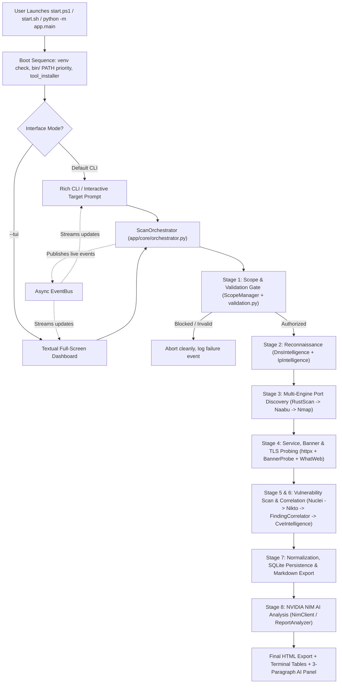

# RootScan

RootScan is a local-first security assessment toolkit written in Python. You give it a domain name or IP address, and it runs an automated pipeline that validates scope, gathers network intelligence, scans for open ports, probes web services and TLS certificates, checks for security issues, stores all evidence on disk and in SQLite, and uses NVIDIA NIM to explain the findings in plain English.

Everything runs from a single terminal, either as a fast Rich-formatted CLI (modeled after RustScan) or as a full-screen Textual terminal dashboard (`--tui`).

Website: https://weanonymous.in  
GitHub: https://github.com/weanonymous01

---

## Table of Contents

1. [What RootScan Does](#1-what-rootscan-does)
2. [How the Whole Workflow Works Step by Step](#2-how-the-whole-workflow-works-step-by-step)
3. [System Architecture and Components](#3-system-architecture-and-components)
4. [Tool Dependency Installer and Fallback Design](#4-tool-dependency-installer-and-fallback-design)
5. [Security and Scope Guardrails](#5-security-and-scope-guardrails)
6. [Assessment Profiles](#6-assessment-profiles)
7. [Installation and Setup](#7-installation-and-setup)
8. [NVIDIA NIM AI Configuration](#8-nvidia-nim-ai-configuration)
9. [Usage Guide (CLI and TUI)](#9-usage-guide-cli-and-tui)
10. [Storage, Reports, and Evidence Layout](#10-storage-reports-and-evidence-layout)
11. [Project Structure](#11-project-structure)
12. [Running Tests](#12-running-tests)

---

## 1. What RootScan Does

Instead of making you run six different tools by hand and copy results from one window to another, RootScan wires the entire assessment lifecycle together:

- Automatically checks whether core standalone scanners (`rustscan`, `httpx`, `nuclei`, `naabu`) exist on your machine and downloads the right binary for your OS and CPU into `./bin/` when missing.
- Normalizes user input (stripping URLs, paths, or trailing ports) and enforces anti-SSRF and scope guardrails before a single packet leaves the machine.
- Collects DNS records and IP ownership/routing metadata (`DnsIntelligence` and `IpIntelligence`).
- Combines multiple port and service engines (`RustScan`, `Naabu`, `Nmap` when installed, `httpx`, `SocketBanner`, `TLSProbe`, and `WhatWeb` when installed) and merges results without losing which tool discovered each detail.
- Runs non-destructive vulnerability and misconfiguration checks (`Nuclei`, plus `Nikto` when installed).
- Deduplicates identical findings, links them to discovered services, and checks CVE IDs against known exploited advisories (`CISA KEV`).
- Saves raw tool outputs, stage JSON snapshots, Markdown, standalone dark-themed HTML, and a local SQLite database (`WAL` mode) indexed by unique scan IDs (`SCN-YYYYMMDD-XXXXX`).
- Sends normalized scan data to NVIDIA NIM so an AI analyst explains what was found, what to check next, and what action to start right now in three simple, jargon-free paragraphs while keeping exact `[ToolName]` credits.

---

## 2. How the Whole Workflow Works Step by Step

Before reading individual modules, here is how all subsystems connect and execute from launch to final report.

### System Pipeline Diagram



### Step-by-Step Execution Flow (How Each System Works Together)

#### Step 0: Launcher, Virtual Environment, and Tool Bootstrap
1. When you run `.\start.ps1` (Windows) or `./start.sh` (Linux/macOS), the script moves into the project folder, activates `./venv`, and puts `./bin` at the very front of `PATH`. Putting `./bin` first is intentional: Python installs a CLI script named `httpx` inside `venv/Scripts` or `venv/bin` for the Python `httpx` library, which would otherwise shadow ProjectDiscovery's `httpx` scanner binary in `./bin`.
2. `app/main.py` also includes an auto-reexec safeguard. If someone invokes `python -m app.main` from a system Python outside `venv`, `app/main.py` automatically re-launches itself using `./venv` Python so dependencies such as `dnspython`, `textual`, and `rich` are always present.
3. Before starting a CLI scan, `check_and_install_missing_tools()` (`app/core/tool_installer.py`) detects your OS (`windows`, `linux`, or `darwin`) and architecture (`amd64` or `arm64`), checks for `rustscan`, `httpx`, `nuclei`, and `naabu`, and downloads any missing binary into `./bin/`.

#### Step 1: Target Validation and Scope Registration
1. The target string goes into `ScanOrchestrator.execute_scan()`, which calls `ScopeManager.register_scope()` (`app/core/scope_manager.py`).
2. `validate_target()` (`app/security/validation.py`) trims whitespace, removes URL prefixes like `https://` or `/path` if pasted as a URL, classifies the input as IPv4, IPv6, or a domain name, and resolves domain names to IPs via `socket.getaddrinfo()`.
3. Every resolved IP is tested against blocked networks (loopback `127.0.0.0/8` and `::1/128`, cloud metadata endpoints such as `169.254.169.254`, link-local `169.254.0.0/16` and `fe80::/10`, multicast, and reserved ranges).
4. Private RFC 1918 subnets (`10.0.0.0/8`, `172.16.0.0/12`, `192.168.0.0/16`) are blocked by default unless explicitly authorized via `--allow-private` or confirmed interactively at the prompt.
5. Once authorized, a collision-resistant scan ID (`SCN-YYYYMMDD-XXXXX`) is created, `target.json` is written under `data/scans/<scan_id>/`, and new rows are inserted into SQLite (`scans` and `targets` tables).

#### Step 2: Passive Network Reconnaissance
1. If the target is a domain, `DnsIntelligence.gather()` (`app/intelligence/dns_intelligence.py`) queries `A`, `AAAA`, `CNAME`, `MX`, `NS`, `SOA`, and `TXT` records using `dnspython` with strict 4-second timeouts.
2. For the primary resolved IP, `IpIntelligence.gather()` (`app/intelligence/ip_intelligence.py`) runs a non-blocking reverse DNS (`PTR`) lookup via `asyncio.to_thread(socket.gethostbyaddr, ...)` and queries `https://rdap.org/ip/<ip>` for netblock CIDR, ownership name, handle, org, address range, and country.
3. Results are stored in `reconnaissance.json`, stamped with `[DnsIntelligence]` and `[IpIntelligence]`.

#### Step 3: Multi-Engine Port Discovery
Rather than relying on one port scanner, RootScan runs up to three layers and merges discoveries into a unified `port_map` keyed by `(port, protocol)`:
1. **RustScan (`RustScanAdapter`)**: Runs `rustscan` in `--scripts none` mode so RustScan finishes cleanly without spawning its own nested Nmap call. Profile `top100` scans RustScan's top 100 ports list; `top1000` uses `--top`; `1-65535` scans the full TCP range. If the `rustscan` binary is unavailable, it automatically drops back to `RustScanAdapter.fast_socket_discovery()`, a built-in async TCP connect scanner probing common ports concurrently.
2. **Naabu (`NaabuAdapter`)**: Runs `naabu -json -silent` as a second verification pass. Any port found by both RustScan and Naabu gets merged rather than duplicated, combining `source_tools` to `["RustScan", "Naabu"]`.
3. **Nmap (`NmapAdapter`)**: If `nmap` is installed on the host `PATH`, RootScan runs `nmap -sV -Pn --open` specifically against the discovered ports (producing XML output parsed by `NmapParser`) to extract deeper service versions and NSE script findings. If `nmap` is not installed (common on a fresh Windows machine), RootScan cleanly logs Nmap as `SKIPPED` in `tool_summary` and records `nmap_service_scan` in `skipped_stages`.
4. As each new port appears, `EventBus` emits `PORT_DISCOVERED` so the CLI or TUI prints `Open <ip>:<port> [via <Tool>]` in real time.

#### Step 4: Service Enumeration, Banner Grabbing, and TLS Inspection
Once open ports are known, RootScan builds candidate web port targets and runs three concurrent/sequential probes:
1. **HTTP Probing (`HttpxAdapter`)**: Builds explicit URLs (`http://<target>:<port>` / `https://<target>:<port>`) and executes ProjectDiscovery `httpx` with `-title -tech-detect -status-code -server -location -json` to capture status codes, redirect targets, page titles, server headers, and detected web technologies. If the `httpx` binary is unavailable, `HttpxAdapter.python_fallback_probe()` uses Python's `httpx.AsyncClient` to capture status codes, server banners, and HTML titles.
2. **Banner and TLS Inspection (`BannerProbe`)**: Checks open ports natively in Python without heavy external dependencies:
   - `SocketBanner` connects passively to non-HTTP banner ports (`21, 22, 23, 25, 110, 143, 587, 3306, 5432, 6379`) and reads initial greeting banners (identifying SSH, FTP, SMTP versions).
   - `TLSProbe` opens a TLS socket with SNI on TLS ports (`443, 465, 636, 993, 995, 8443`) to record the negotiated TLS protocol version, cipher suite, and certificate length.
3. **WhatWeb (`WhatWebAdapter`)**: If the `whatweb` binary is installed (for instance on Kali Linux), RootScan runs it against up to 3 web URLs for additional plugin fingerprinting. If missing, it records `SKIPPED (binary not installed; web tech fingerprinted by httpx)`.
4. Consolidated ports and services are saved to `ports.json`, `services.json`, and SQLite (`services` table).

#### Step 5 and 6: Vulnerability Assessment and Correlation
1. **Nuclei (`NucleiAdapter`)**: Runs against normalized web URLs (or the target host if no web URLs exist). In the `quick` profile, Nuclei targets fast, high-signal templates (`ssl/`, `http-missing-security-headers.yaml`, `directory-listing-no-host-header.yaml`, `server-status.yaml`, Apache/Nginx misconfigurations, exposed `.git/config`, `phpinfo`, and backup listings) with rate limits and Interactsh disabled (`-ni`) to prevent hangs. Larger profiles (`standard`, `deep`) expand severity filters based on `config/profiles.toml`. Raw JSONL output is saved in `evidence/` and parsed by `NucleiParser`.
2. **Nikto (`NiktoAdapter`)**: When installed, Nikto scans the primary web URL and exports JSON findings. When missing, it is skipped cleanly because Nuclei already performs web checks.
3. **Correlation and Enrichment (`FindingCorrelator` and `CveIntelligence`)**:
   - `deduplicate_findings()` groups identical detections by `(title.lower(), port, cve_id)`, merges `source_tool` credits, upgrades confidence if any tool reported `CONFIRMED`, and combines unique evidence snippets.
   - `link_findings_to_services()` attaches matching service names and observed versions to port-level findings.
   - `enrich_findings_with_cve_intelligence()` tags CVEs found in `CveIntelligence.KNOWN_EXPLOITED_CVES` with `[CISA KEV Exploited]`, elevates severity if needed, and appends NVD, MITRE, and CISA reference links.
   - Final findings are persisted to `vulnerabilities.json` and the SQLite `findings` table.

#### Step 7: Data Normalization and Initial Reports
`ScanOrchestrator` bundles target metadata, reconnaissance, ports, services, deduplicated findings, `tool_summary`, `skipped_stages`, and assessment limitations into the Pydantic `FinalReport` schema (`app/reports/schemas.py`). It saves `final_report.json`, renders `final_report.md` via `ReportGenerator`, and updates `scans` status in SQLite.

#### Step 8: NVIDIA NIM AI Security Analysis
If `NVIDIA_NIM_API_KEY` is configured in `.env`, the report passes to `ReportAnalyzer` (`app/ai/report_analyzer.py`) and `NimClient` (`app/ai/nim_client.py`):
- **Single-Pass vs. Multi-Section Mode**: When total ports + services + findings are `<= 50`, `NimClient.analyze_scan_report()` sends one structured JSON summary containing reconnaissance, ports, services, findings (up to 40), and `tool_summary`. Above 50 items, `ReportAnalyzer` chunks findings into batches of 10, summarizes each batch via `section_analysis.txt`, and merges them via `final_synthesis.txt`.
- **Thinking Suppression for Reasoning Models**: If the configured model contains `"nemotron"`, `NimClient._complete()` passes `extra_body={"chat_template_kwargs": {"enable_thinking": False}}` so reasoning traces do not stall or consume the token budget.
- **Plain-English 3-Paragraph Formatting**: `SYSTEM_PROMPT_ANALYST` and `THREE_PARAGRAPH_PLAIN_STYLE` enforce simple everyday English without technical jargon, markdown headings, bullets, or bold markers, while keeping `[ToolName]` tags accurate. `format_three_paragraph_summary()` strips leftover markdown and labels, then `build_ai_report_model()` populates `AIAnalysisReport`.
- Results are stored in `ai_analysis.json` and the SQLite `ai_analyses` table.

#### Step 9: Final Report Refresh and UI Display
1. `ScanOrchestrator` updates `final_report.json` and `final_report.md` with the AI execution result in `tool_summary`, and generates the standalone HTML report (`final_report.html`) via `HtmlReportExporter` (embedding findings, tool credits, charts/badges, and the AI analysis).
2. `EventBus` emits `SCAN_COMPLETED`.
3. In the CLI, Rich displays four structured tables (`RECONNAISSANCE & NETWORK INTELLIGENCE`, `DISCOVERED PORTS & SERVICES`, `VULNERABILITY & CONFIGURATION FINDINGS`, and `TOOL EXECUTION AUDIT`), followed by the 3-paragraph `AI Security Assessment Overview` panel and the final report paths table.

---

## 3. System Architecture and Components

| Subsystem | Main Files | Responsibility |
|---|---|---|
| Entry & Launchers | `start.ps1`, `start.sh`, `app/main.py` | Venv activation, `./bin` PATH ordering, auto-reexec into venv, CLI vs TUI dispatch |
| Configuration | `app/core/configuration.py`, `config/*.toml`, `.env` | Loads `.env`, `settings.toml`, `tools.toml`, and `profiles.toml`; ensures data/bin dirs exist |
| Async Event Bus | `app/core/event_bus.py` | Pub/sub bus (`EventType`) decoupling backend scanners from CLI/TUI output |
| Task Manager | `app/core/task_manager.py` | Executes binaries with `asyncio.create_subprocess_exec` (never `shell=True`), streams stdout/stderr, enforces timeouts, tracks active PIDs for cancellation |
| Scope & Validation | `app/security/validation.py`, `app/core/scope_manager.py` | Normalizes domains/IPs/URLs, blocks loopback/metadata/reserved ranges, enforces private-network scope lock |
| Tool Installer | `app/core/tool_installer.py` | OS/arch detection and GitHub release installer for standalone binaries (`rustscan`, `httpx`, `nuclei`, `naabu`) |
| Orchestrator | `app/core/orchestrator.py` | Coordinates stages 1 through 8, merges multi-tool outputs, records evidence, handles cancellation |
| Recon & Intelligence | `app/intelligence/dns_intelligence.py`, `ip_intelligence.py`, `correlation.py`, `cve_intelligence.py` | DNS records, RDAP/rDNS lookup, finding deduplication, service correlation, CISA KEV enrichment |
| Scanner Adapters | `app/scanners/base.py`, `rustscan.py`, `naabu.py`, `nmap.py`, `httpx.py`, `banner_probe.py`, `whatweb.py`, `nuclei.py`, `nikto.py` | Build fixed CLI arg arrays, invoke `TaskManager`, provide async Python fallbacks, parse native outputs |
| Output Parsers | `app/parsers/nmap_parser.py`, `nuclei_parser.py` | Parse Nmap XML and Nuclei JSONL into normalized Pydantic schemas |
| Persistence | `app/database/models.py`, `repository.py`, `app/reports/storage.py` | SQLite WAL storage (9 relational tables) and per-scan `data/scans/<scan_id>/` file storage |
| Report Exporters | `app/reports/generator.py`, `html_exporter.py`, `comparator.py`, `schemas.py` | Markdown, standalone HTML, JSON reports, and two-scan comparison (`diff`) |
| AI Analyst | `app/ai/nim_client.py`, `report_analyzer.py`, `app/ai/prompts/*.txt`, helper prompt modules | NVIDIA NIM OpenAI-compatible async client, chunked synthesis, 3-paragraph normalizer, historical Q&A |
| Terminal Interfaces | `app/cli.py`, `app/tui/app.py` | Rich RustScan-style CLI plus 8-screen Textual TUI dashboard |

---

## 4. Tool Dependency Installer and Fallback Design

RootScan maintains a clean split between **self-contained binaries** and **system tools** so it works immediately on both Windows and Kali/Ubuntu Linux:

| Tool | Category | Windows Auto-Install | Linux / Kali Support | Behavior When Missing |
|---|---|---|---|---|
| `rustscan` | Port discovery | Auto-downloaded to `./bin/` | Auto-downloaded to `./bin/` or `apt` | Falls back to built-in async Python TCP scanner (`RustScan-SocketFallback`) |
| `naabu` | Port discovery | Auto-downloaded to `./bin/` | Auto-downloaded to `./bin/` | Marked `SKIPPED`; covered by `RustScan` |
| `httpx` | HTTP probe / tech | Auto-downloaded to `./bin/` | Auto-downloaded to `./bin/` or `httpx-toolkit` | Falls back to `HttpxAdapter.python_fallback_probe()` |
| `nuclei` | Vulnerability scan | Auto-downloaded to `./bin/` | Auto-downloaded to `./bin/` or `apt` | Marked `SKIPPED` |
| `SocketBanner` / `TLSProbe` | Banner & TLS probe | Built-in Python | Built-in Python | Always available natively |
| `DnsIntelligence` / `IpIntelligence` | DNS & RDAP recon | Built-in Python | Built-in Python | Always available natively |
| `nmap` | Deep service / NSE | Manual (`winget install Insecure.Nmap`) | Installed by `./install.sh` (`apt`) | Marked `SKIPPED`; ports/services covered by RustScan, Naabu, httpx, BannerProbe |
| `whatweb` | Web tech plugins | Manual (requires Ruby) | Installed by `./install.sh` (`apt`) | Marked `SKIPPED`; web tech covered by `httpx` |
| `nikto` | Web server checks | Manual (requires Perl) | Installed by `./install.sh` (`apt`) | Marked `SKIPPED`; web checks covered by `Nuclei` |

### Why `Nmap`, `WhatWeb`, and `Nikto` Are Not Auto-Downloaded by `tool_installer.py`

Users running on Windows often notice `Nmap`, `WhatWeb`, and `Nikto` listed as `SKIPPED` in the Tool Execution Audit table and wonder why the installer did not fetch them.

The reason is packaging, not a bug:
- `tool_installer.py` fetches **single portable binary archives** (`rustscan`, `httpx`, `nuclei`, `naabu`) from GitHub releases and drops the executable directly into `./bin/`.
- `Nmap` on Windows requires a full OS installer (along with the Npcap packet-capture driver and NSE script files).
- `WhatWeb` is written in Ruby and `Nikto` is written in Perl; neither provides a standalone single-file `.exe` release for Windows.
- On Kali Linux or Debian/Ubuntu, running `./install.sh` installs `nmap`, `whatweb`, `nikto`, `nuclei`, `rustscan`, and `httpx-toolkit` via `apt-get`, so all of them run automatically when present on `PATH`.

---

## 5. Security and Scope Guardrails

RootScan treats every target address, banner, and HTTP header as untrusted input:

- **Subprocess Safety (`TaskManager`)**: Every external tool runs with `asyncio.create_subprocess_exec(*cmd_list)` and explicit argument arrays. `shell=True` is never used, preventing command injection through target inputs or responses.
- **Anti-SSRF and Network Blocking (`validation.py`)**: Domain targets are resolved via `socket.getaddrinfo()` before scanning starts, and every resolved IP (not only direct IP inputs) is checked against blocked ranges:
  - Loopback: `127.0.0.0/8`, `::1/128`
  - Link-local & Cloud Metadata: `169.254.0.0/16`, `169.254.169.254/32`, `fd00:ec2::254/128`, `100.100.100.200/32`, `fe80::/10`
  - Reserved / Multicast / Current Network: `0.0.0.0/8`, `224.0.0.0/4`, `240.0.0.0/4`
- **Private Subnet Scope Lock (`ScopeManager`)**: RFC 1918 and IPv6 unique-local ranges (`10.0.0.0/8`, `172.16.0.0/12`, `192.168.0.0/16`, `fc00::/7`) are blocked unless authorized with `--allow-private` or confirmed interactively when prompted.
- **Non-Destructive Execution**: Built-in scanners and templates run discovery and misconfiguration checks only; active exploit payloads are never launched.
- **Prompt Injection Boundary**: `SYSTEM_PROMPT_ANALYST` instructs the LLM to treat all HTTP headers, service banners, and scanner outputs strictly as untrusted data and never execute instructions embedded inside them.

---

## 6. Assessment Profiles

Profiles are configured in `config/profiles.toml` and selected using `--profile <name>`:

| Profile | Port Range | Rate Limit | Timeout | Nuclei Severities (Non-Quick) | Intended Use |
|---|---|---|---|---|---|
| `quick` (default) | `top100` | `1000` (Nuclei capped at `50`) | `300s` | Curated quick templates (`critical,high,medium,low,info`) | Fast daily triage in under a minute |
| `standard` | `top1000` | `1500` (Nuclei capped at `100`) | `900s` | `critical`, `high`, `medium` | Balanced assessment of common ports and services |
| `deep` | `1-65535` | `2000` (Nuclei capped at `100`) | `2400s` | `critical`, `high`, `medium`, `low` | Full TCP port range and deeper web/vulnerability coverage |
| `custom` | `top1000` | `1000` | `1200s` | `critical`, `high` | Baseline customizable profile |

Core runtime defaults in `config/settings.toml` and `config/tools.toml` allow tuning blocked IP ranges, timeouts, concurrency (`max_concurrent_scans`, `max_tool_workers`), and per-tool metadata without editing Python code.

---

## 7. Installation and Setup

### Prerequisites

- **Python 3.11 or newer**
- **Git**
- Optional: **NVIDIA NIM API Key** from https://build.nvidia.com (RootScan still completes all scanning, database storage, and Markdown/HTML reports if no AI key is set)

### Windows (PowerShell)

```powershell
git clone https://github.com/weanonymous01/RootScan.git
cd RootScan
.\install.ps1
.\start.ps1
```

What `.\install.ps1` does automatically:
1. Checks that `python` is installed.
2. Creates `./venv` and installs all packages from `requirements.txt`.
3. Copies `.env.example` to `.env` if `.env` does not exist yet.
4. Initializes the SQLite database (`data/database/rootscan.db`).
5. Runs `check_and_install_missing_tools(auto_download=True)` to download `rustscan.exe`, `httpx.exe`, `nuclei.exe`, and `naabu.exe` into `.\bin\`.

### Linux (Kali Linux, Ubuntu, Debian)

```bash
git clone https://github.com/weanonymous01/RootScan.git
cd RootScan
chmod +x install.sh start.sh
./install.sh
./start.sh
```

What `./install.sh` does automatically:
1. Detects `/etc/os-release` and checks Python 3.
2. Installs `nmap`, `whatweb`, `nikto`, `nuclei`, `rustscan`, `httpx-toolkit`, `git`, `curl`, `python3-venv`, and `python3-pip` via `apt-get` (and uses `go install` as fallback if needed).
3. Creates `./venv` and installs Python packages from `requirements.txt`.
4. Initializes `.env` and SQLite on first run, while `start.sh` automatically fetches any missing standalone binary (such as `naabu` or `rustscan`) into `./bin/` at launch.

---

## 8. NVIDIA NIM AI Configuration

Open `.env` in the repository root and add your key:

```env
NVIDIA_NIM_API_KEY=nvapi-your-key-here
NVIDIA_NIM_MODEL=nvidia/nemotron-3.5-lightning-30b-a3b
NVIDIA_NIM_BASE_URL=https://integrate.api.nvidia.com/v1
```

Notes on model selection and behavior:
- `.env.example` defaults to `meta/llama-3.3-70b-instruct` if you do not change `NVIDIA_NIM_MODEL`.
- If you select a Nemotron reasoning model (such as `nvidia/nemotron-3.5-lightning-30b-a3b`), `NimClient` automatically disables internal chain-of-thought reasoning (`enable_thinking: False`) so responses stay fast and avoid token exhaustion.
- You can verify API connectivity anytime without running a scan:

```powershell
# Windows
.\start.ps1 ai-test
```

```bash
# Linux
./start.sh ai-test
```

---

## 9. Usage Guide (CLI and TUI)

### Interactive RustScan-Style Mode (Default)

Running `.\start.ps1` (or `./start.sh`) with no flags prints the banner, checks/downloads standalone tool binaries, displays active engines, and prompts:

```text
[?] Enter Target IP or Domain to scan:
```

At that prompt you can type:
- A domain or IP (for example `scanme.nmap.org` or `57.144.40.1`)
- A target with flags (for example `10.10.203.136 --profile standard --allow-private`)
- Utility keywords: `tools`, `history`, `ai-test`, or `exit` / `quit`

### Direct CLI Flags and Subcommands

Use `.\start.ps1` on Windows or `./start.sh` on Linux:

```bash
# Direct target scan (RustScan style)
./start.sh -a scanme.nmap.org -u 5000 --profile quick

# Scan subcommand
./start.sh scan example.com --profile standard

# Scan an internal lab target (TryHackMe / HackTheBox / LAN)
./start.sh -a 10.10.203.136 --allow-private

# Check tool availability and versions
./start.sh tools

# Test NVIDIA NIM connection and configured model
./start.sh ai-test

# View past scans stored in SQLite
./start.sh history

# Compare two scans (shows new/closed ports, new/resolved findings, risk delta)
./start.sh compare SCN-20261111-AAAAA SCN-20261111-BBBBB

# Export a saved report
./start.sh export SCN-20261111-8BC99 --format html --out report.html
./start.sh export SCN-20261111-8BC99 --format markdown
./start.sh export SCN-20261111-8BC99 --format json

# Delete a scan record and all on-disk evidence
./start.sh delete SCN-20261111-8BC99
```

### Full-Screen Textual TUI (`--tui`)

Launch the full-screen terminal dashboard:

```bash
./start.sh --tui
# or
.\start.ps1 --tui
```

Keybindings inside the TUI:
- `1` : New Scan (target input, profile selector, private-range toggle)
- `2` : History (browse past SQLite scans and open saved reports)
- `3` : AI Analyst (load any saved report and ask follow-up questions in multi-turn chat)
- `4` : Tools (inspect detected scanners and binary paths/versions)
- `5` : Settings (view configuration, profiles, and NVIDIA NIM settings)
- `Esc` : Go back to previous screen
- `q` : Quit

---

## 10. Storage, Reports, and Evidence Layout

Every assessment writes two complementary stores:

### 1. Per-Scan Artifact Directory (`data/scans/SCN-YYYYMMDD-XXXXX/`)

| File / Folder | Purpose |
|---|---|
| `target.json` | Validated target metadata, resolved IPs, and private-scope flag |
| `reconnaissance.json` | DNS records (`DnsIntelligence`) and reverse DNS / RDAP data (`IpIntelligence`) |
| `ports.json` | Deduplicated open ports with combined `source_tools` credit |
| `services.json` | Exposed services, HTTP banners, technologies, and TLS probe details |
| `vulnerabilities.json` | Deduplicated, correlated, and CVE-enriched findings |
| `evidence/` | Raw scanner output files (`rustscan_output.raw`, `httpx_output.jsonl`, `nuclei_output.*`, `nmap_output.xml`, etc.) |
| `ai_analysis.json` | 3-paragraph plain-English executive summary and structured AI fields |
| `final_report.json` | Full consolidated `FinalReport` JSON matching Pydantic schemas |
| `final_report.md` | GitHub Flavored Markdown report with summary metrics, tables, and AI section |
| `final_report.html` | Self-contained dark-theme HTML report ready to open offline in any browser |

### 2. SQLite Database (`data/database/rootscan.db`)

Configured in `WAL` mode with foreign keys enabled across 9 normalized tables (`scans`, `targets`, `scan_stages`, `scan_jobs`, `assets`, `services`, `findings`, `evidence`, `ai_analyses`). This backs instant history queries, cross-scan diffs, deletion cleanup, and multi-turn historical AI Q&A.

---

## 11. Project Structure

```text
RootScan/
├── app/
│   ├── ai/
│   │   ├── prompts/              # system.txt, section_analysis.txt, final_synthesis.txt
│   │   ├── nim_client.py         # Async NVIDIA NIM client, 3-paragraph normalizer, Q&A
│   │   ├── report_analyzer.py    # Single-pass or multi-batch AI synthesis orchestrator
│   │   └── ...                   # Finding explainer, attack path, exploit/remediation helpers
│   ├── core/
│   │   ├── configuration.py      # .env and config/*.toml loader
│   │   ├── event_bus.py          # Async Pub/Sub event bus for live CLI/TUI updates
│   │   ├── orchestrator.py       # 8-stage assessment pipeline coordinator
│   │   ├── scope_manager.py      # Authorized scope registry and boundary checks
│   │   ├── task_manager.py       # Non-shell subprocess executor with timeouts and streaming
│   │   └── tool_installer.py     # OS/arch binary downloader for ./bin/
│   ├── database/
│   │   ├── models.py             # SQLite schema and dataclass records
│   │   └── repository.py         # Thread-safe CRUD repository
│   ├── intelligence/
│   │   ├── dns_intelligence.py   # DNS record resolver (dnspython)
│   │   ├── ip_intelligence.py    # Reverse DNS + rdap.org ownership/CIDR lookup
│   │   ├── correlation.py        # Finding deduplication and service linking
│   │   └── cve_intelligence.py   # CISA KEV lookup and advisory URLs
│   ├── parsers/
│   │   ├── nmap_parser.py        # Nmap XML parser
│   │   └── nuclei_parser.py      # Nuclei JSONL parser
│   ├── reports/
│   │   ├── comparator.py         # Two-scan diff engine
│   │   ├── generator.py          # Markdown report builder
│   │   ├── html_exporter.py      # Standalone dark HTML report exporter
│   │   ├── schemas.py            # Pydantic v2 data models
│   │   └── storage.py            # SCN-YYYYMMDD-XXXXX directory & evidence manager
│   ├── scanners/
│   │   ├── base.py               # BaseScannerAdapter interface
│   │   ├── banner_probe.py       # Native SocketBanner and TLSProbe inspector
│   │   ├── httpx.py              # httpx adapter + async Python HTTP fallback
│   │   ├── naabu.py              # Naabu port scanner adapter
│   │   ├── nikto.py              # Nikto web scanner adapter
│   │   ├── nmap.py               # Nmap service/NSE scanner adapter
│   │   ├── nuclei.py             # Nuclei vulnerability scanner adapter
│   │   ├── rustscan.py           # RustScan adapter + async socket discovery fallback
│   │   └── whatweb.py            # WhatWeb fingerprinting adapter
│   ├── security/
│   │   └── validation.py         # URL normalization, DNS rebinding & anti-SSRF checks
│   ├── tui/
│   │   └── app.py                # Full-screen Textual terminal application
│   ├── cli.py                    # Rich RustScan-style CLI commands and tables
│   └── main.py                   # Entrypoint with venv auto-reexec and CLI/TUI router
├── config/
│   ├── profiles.toml             # quick, standard, deep, custom profiles
│   ├── settings.toml             # Paths, blocked IP ranges, AI and execution defaults
│   └── tools.toml                # Tool binary metadata and timeouts
├── bin/                          # Auto-downloaded portable binaries (created at runtime)
├── data/                         # Runtime SQLite DB and per-scan reports/evidence
├── docs/                         # Supplemental architecture, install, and dev notes
├── tests/                        # Unit and integration test suite + tool output fixtures
├── install.ps1 / start.ps1       # Windows installer and launcher
├── install.sh / start.sh         # Linux installer and launcher
├── pyproject.toml
├── requirements.txt
└── .env.example
```

---

## 12. Running Tests

The test suite uses `pytest` and `pytest-asyncio` to test input validation, anti-SSRF rejection, scanner parsers, tool installer OS/architecture logic, finding deduplication, SQLite repository lifecycle, Markdown/HTML/comparator exports, Textual TUI smoke mounting, and 3-paragraph AI summary normalization:

```powershell
# Windows
.\venv\Scripts\pytest -v
```

```bash
# Linux
./venv/bin/pytest -v
```

---

## License

Distributed under the [MIT License](LICENSE).
