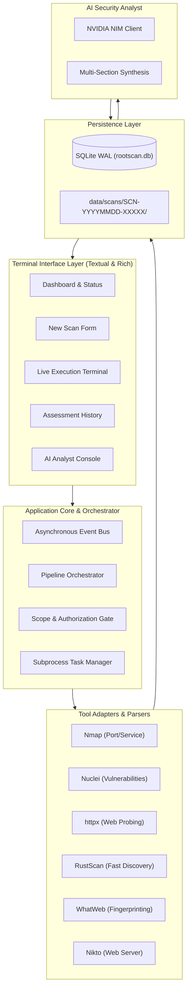

# RootScan Architecture Specification

## 1. Architectural Overview

RootScan is a **modular monolithic security assessment toolkit** written in Python 3.11+. It orchestrates local reconnaissance and vulnerability scanning tools, normalizes their heterogeneous outputs into consistent Pydantic models, persists assessment records and raw evidence, and leverages NVIDIA NIM inference for evidence-grounded security analysis.

---

## 2. Core Subsystems

### 2.1 Async Event Bus (`app/core/event_bus.py`)
Decouples scanner execution from terminal presentation. The orchestrator and scanner adapters emit typed events (`STAGE_STARTED`, `TOOL_OUTPUT`, `PORT_DISCOVERED`, `SCAN_COMPLETED`). Textual widgets and the CLI subscribe to these streams without blocking the event loop.

### 2.2 Security & Scope Guardrails (`app/security/validation.py` & `app/core/scope_manager.py`)
RootScan treats all targets and scanner outputs as untrusted data:
- **SSRF Defense**: Blocks cloud metadata endpoints (`169.254.169.254`, `fd00:ec2::254`).
- **Loopback Protection**: Rejects `127.0.0.1` and `::1` by default.
- **Private Subnet Authorization**: Mandates explicit operator scope authorization before scanning RFC 1918 internal subnets (`10.0.0.0/8`, `172.16.0.0/12`, `192.168.0.0/16`).
- **Subprocess Safety**: External tools run via `asyncio.create_subprocess_exec` with explicit parameter arrays. `shell=True` is strictly prohibited.

### 2.3 Tool Adapters (`app/scanners/base.py`)
All scanner integrations inherit from `BaseScannerAdapter`:
- `is_available`: Inspects host `PATH`.
- `get_version`: Queries tool version string.
- `build_command`: Safely formats argument list without shell interpolation.
- `parse_output`: Translates native output (XML, JSON, JSONL) into unified `NormalizedFinding` and `ServiceResult` schemas.

### 2.4 Correlation & CVE Intelligence (`app/intelligence/`)
- **FindingCorrelator**: Deduplicates identical findings discovered across multiple tools, merges evidence references, and links findings with discovered listening ports.
- **CveIntelligence**: Checks findings against the CISA Known Exploited Vulnerabilities (KEV) catalog and enriches CVE records with official advisories.

### 2.5 Storage Architecture (`app/reports/` & `app/database/`)
Each scan is assigned a cryptographic collision-resistant ID (`SCN-YYYYMMDD-XXXXX`):
- **SQLite Database (`data/database/rootscan.db`)**: Indexed metadata for rapid search, history querying, and multi-turn AI conversations.
- **File System (`data/scans/<SCN-ID>/`)**: Complete stage records (`target.json`, `ports.json`, `services.json`, `vulnerabilities.json`), raw tool evidence (`evidence/`), and rendered reports (`final_report.json`, `final_report.md`, `final_report.html`, `ai_analysis.json`).
